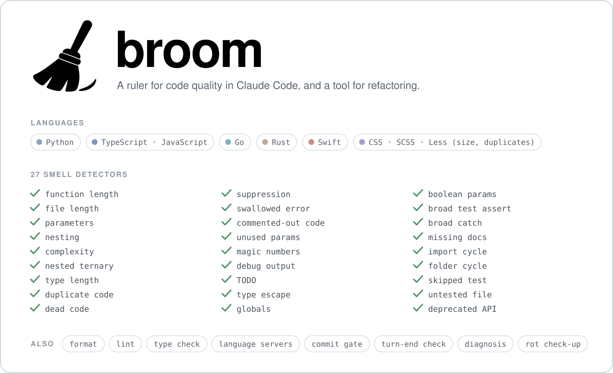
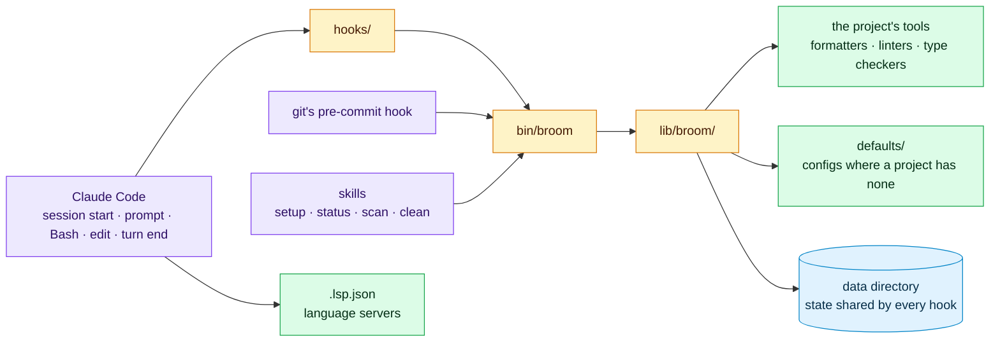

# broom 🧹

<picture>
  <source media="(prefers-color-scheme: dark)" srcset="assets/hero-dark.svg">
  
</picture>

> A ruler for code quality in Claude Code, and a tool for refactoring.

[](https://github.com/jinhuang712/claude-code-broom/releases) [](https://docs.claude.com/en/docs/claude-code/plugins)   [](LICENSE)

broom is a tool for the coding agent, with no model of its own. It holds Claude's changes to the project's own formatter, linter and type checker before they leave the session, and it measures a whole repo one way when Claude is asked how the code is doing. At a change it judges that change and the code it touches, so a legacy repo's old warnings don't land on a small fix. Type errors are the one exception, since a changed signature breaks callers anywhere.

[中文](docs/README.zh-CN.md)

---

## What it does

- 🧰 **Sets up**: When a session opens in a repo, broom notices what's missing and Claude offers to install and configure it.
- 🧹 **Sweeps**: After an edit it formats the file and tells Claude what a fast linter finds. At a commit and at a turn's end it formats, lints and type-checks Claude's changes and holds them back until they're clean.
- 🧪 **Tests ran**: A turn that changed code ends once the project's tests ran on it, or with a reason the user sees.
- 👃 **Smells**: A change that makes code too long, nests too deep or repeats itself is held back until it is cleaned or accepted with a reason.
- 👀 **Sees**: Language servers for six languages give Claude diagnostics as it edits.
- 📊 **Diagnoses**: `broom diagnose`, `broom stats` and `broom compare` give a whole repo's numbers before a refactor and after it.
- 🩺 **Checks up**: At session start it counts a repo's rot and tells Claude once when a number grew.

> [!IMPORTANT]
> Nothing is installed without the user's yes. A finding passes fixed, or accepted with a reason on record.

---

## Install

```text
/plugin marketplace add jinhuang712/claude-code-broom
/plugin install broom@claude-code-broom
```

It needs macOS, Claude Code 2.1.271 or later, Python 3.9+ as `python3`, and git. [INSTALL.md](docs/INSTALL.md) has the rest: the shell way, the tools per language, updating and removing.

> [!WARNING]
> Linux is untested, and Windows is not supported.

---

## How to use

Start a session in a repo. When a tool or a config is missing, Claude offers `/broom:setup`, which asks at most two questions.

Then let Claude work. When it commits a change that breaks a rule, the commit is held back with a report:

```text
[broom] Commit blocked: 2 issue(s) in the files being committed. Fix them and commit again.

oxlint (~/code/app):
  src/api/client.ts:42:5  typescript(no-floating-promises)  Promises must be awaited
tsc (~/code/app):
  src/pages/home.tsx:17:9  TS2345  Argument of type 'string' is not assignable to 'number'  [not in the changed files]

Trying again passes nothing: only a fix does, or accepting with a reason. If one predates this change or is a false positive, run `broom known --accept "<why>"`, then commit again.
```

Claude fixes the findings and commits again. broom has three commands, and you need none of them for that:

| Command | What it does |
|---|---|
| `/broom:setup` | installs the missing tools and adds configs, after asking |
| `/broom:status` | says which checks run, and what broom stopped, fixed and let through lately |
| `/broom:scan` | runs the tools on a scope and lists what it finds, fixing nothing |

A scan takes its scope in your own words:

```text
/broom:scan
/broom:scan src/api
/broom:scan the last 3 commits
```

> [!TIP]
> To have the findings fixed, say which. Claude cleans up worst first, in small, tested batches.

---

## Configuration

Four settings in `/config` start at defaults and are never asked. A `.broom.json` at the repo root overrides them for one repo, excludes paths and moves the smell limits. [F7: Settings](docs/features/F7-settings.md) lists them.

---

## Architecture

Claude Code starts one of broom's hooks at a session start, a prompt, a Bash call, a Bash command that failed, an edit and a turn's end. The hook runs the project's tools on what changed, then exits with a block, a note or nothing.



---

## Docs

- [PROPOSAL.md](docs/PROPOSAL.md) says why broom exists.
- [PHILOSOPHY.md](docs/PHILOSOPHY.md) holds its stances.
- [DESIGNS.md](docs/DESIGNS.md) holds the commitments every design must meet.
- [FEATURES.md](docs/FEATURES.md) lists what it does.
- [CLI.md](docs/CLI.md) describes the `broom` command.
- [INSTALL.md](docs/INSTALL.md) covers installing, updating and removing.
- [GLOSSARY.md](docs/GLOSSARY.md) fixes the terms.
- [ARCHITECTURE.md](docs/specs/ARCHITECTURE.md) maps the parts.
- [GOALS.md](docs/plan/GOALS.md) holds what is checked.
- [ROADMAP.md](docs/plan/ROADMAP.md) says what comes next.
- [ISSUES.md](docs/plan/ISSUES.md) and [TODO.md](docs/plan/TODO.md) hold the open work and the open questions.
- [CONTRIBUTING.md](docs/CONTRIBUTING.md) says how to change broom.
- [AGENTS.md](AGENTS.md) holds the rules for agents that work on it.
- [CHANGELOG.md](CHANGELOG.md) lists each release.

---

## License

[MIT](LICENSE)
